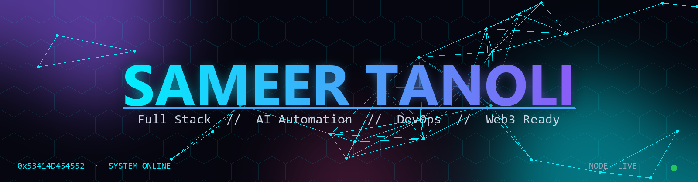
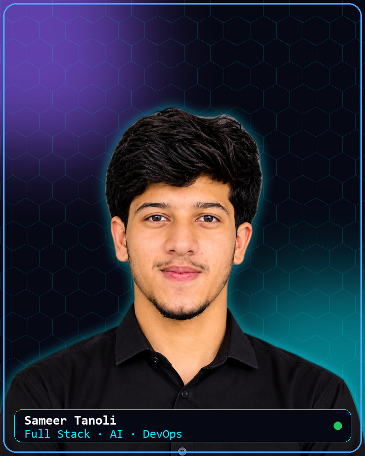

<div align="center">
  

  <a href="https://github.com/sameer-programmer705">
    
  </a>
</div>

<br>

## `01` // About Me

<table>
<tr>
<td width="60%" valign="top">

```ts
const sameer: Engineer = {
    role: "Full Stack Developer · AI Automation · DevOps",
    location: "Pakistan 🇵🇰",
    status: "Online and shipping",

    stack: {
        backend:  ["Laravel", "NestJS", "Node.js", "FastAPI"],
        frontend: ["React", "Next.js", "TypeScript", "Tailwind"],
        data:     ["PostgreSQL", "MySQL", "Redis", "Prisma", "pgvector"],
        devops:   ["Docker", "Linux", "Nginx", "Caddy", "CI/CD"],
        ai:       ["Voice agents", "Local LLMs", "Automation"],
    },

    building: ["AI voice platforms", "CRMs", "Scraping pipelines"],
    next:     ["Web3", "Smart contracts", "On-chain apps"],
};
```

> *Ship it. Containerise it. Automate it.*

</td>
<td width="40%" align="center" valign="middle">



</td>
</tr>
</table>

## `02` // Connect

<div align="center">

[](mailto:sameercoder0@gmail.com)
[](https://github.com/sameer-programmer705)

</div>

## `03` // Tech Stack

**Backend and APIs**


**Frontend**


**Data**


**DevOps and Cloud**


**Tools**


<p>
  
  
  
  
  
  
  
  
  
  
  
  
  
  
</p>

## `04` // What I Build

<table>
<tr>
<td width="33%" valign="top">

### 🤖 AI Automation
Self hosted AI voice agent platform: Asterisk telephony, FastAPI backend, local LLMs through Ollama, pgvector memory, Redis queues and a React dashboard, all in Docker Compose behind Caddy.

`Python` `FastAPI` `Ollama` `Asterisk` `Docker`

</td>
<td width="33%" valign="top">

### ⚙️ Backend Systems
Role based CRMs and finance tools in Laravel, plus NestJS and Express APIs with PostgreSQL, TypeORM, Prisma, Stripe payments and Twilio messaging.

`Laravel` `NestJS` `Node.js` `PostgreSQL`

</td>
<td width="33%" valign="top">

### 🌐 Modern Frontends
Fast, polished interfaces in React and Next.js with TypeScript and Tailwind, from business dashboards to customer facing sites.

`React` `Next.js` `TypeScript` `Tailwind`

</td>
</tr>
<tr>
<td width="33%" valign="top">

### 🕸️ Data and Scraping
Browser automation and lead extraction pipelines that collect, clean and organise business data at scale.

`Python` `Playwright` `Puppeteer`

</td>
<td width="33%" valign="top">

### 🚀 DevOps
Containerised deployments, reverse proxies, Linux servers and automated pipelines, so releases are repeatable and quick.

`Docker` `Linux` `Nginx` `CI/CD`

</td>
<td width="33%" valign="top">

### ⛓️ Web3, next up
Moving into the decentralised web: wallets, smart contracts and on-chain apps on top of my full stack and DevOps base.

`Solidity` `Ethers.js` `Hardhat`

</td>
</tr>
</table>

## `05` // GitHub Analytics

<table>
<tr>
<td width="50%" align="center" valign="middle">

</td>
<td width="50%" align="center" valign="middle">

</td>
</tr>
<tr>
<td width="50%" align="center" valign="middle">

</td>
<td width="50%" align="center" valign="middle">

</td>
</tr>
<tr>
<td width="50%" align="center" valign="middle">

</td>
<td width="50%" align="center" valign="middle">

</td>
</tr>
</table>

<div align="center">
<br>

</div>

<div align="center">
  
</div>
